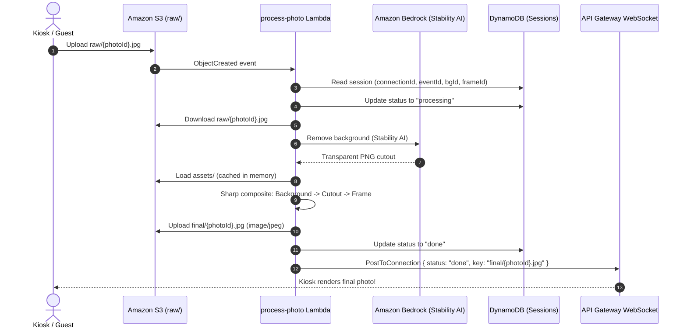

# `services/process-photo`

Photobooth image processing Lambda service:
**S3 Event → Bedrock AI Background Removal → Sharp Compositing → S3 Upload → WebSocket Notification**.

Part of the **ARCUS Photobooth System**.

---

## Architecture Flow



---

## Checklist Coverage

| # | Task | Implementation | Status |
|---|---|---|---|
| 1 | Lambda handler triggered by S3 ObjectCreated on `raw/` | `src/index.ts` (`handler`) | ✅ Done |
| 2 | Read the raw photo from S3 (`raw/{photoId}.jpg`) | `src/s3.ts` (`readPhotoFromS3`) | ✅ Done |
| 3 | Bedrock call for background removal (check model & region) | `src/bedrock.ts` (`removeBackgroundWithBedrock`) | ✅ Done |
| 4 | Load background and frame from `assets/` with memory cache | `src/assets.ts` (`loadBackgroundAndFrame`) | ✅ Done |
| 5 | Sharp compositing: Background -> Cutout -> Frame | `src/composite.ts` (`compositePhoto`) | ✅ Done |
| 6 | Write `final/{photoId}.jpg` (image/jpeg, retry-safe overwrite) | `src/s3.ts` (`writeFinalPhotoToS3`) | ✅ Done |
| 7 | Look up connection ID, send result, ignore `GoneException` | `src/websocket.ts` (`sendWebSocketNotification`) | ✅ Done |
| 8 | Send error messages on failure, update DynamoDB status | `src/index.ts` error handling block | ✅ Done |
| 9 | Test locally with sample photos | `tests/test-bedrock.ts`, `tests/local-runner.ts` | ✅ Done |
| 10 | Tune memory and timeout | Configured: 2048 MB memory, 60s timeout | ✅ Done |
| 11 | Package Sharp for Lambda runtime | `scripts/package-lambda.sh` (Linux native binaries) | ✅ Done |

---

## Lambda Sizing & Tuning

| Configuration | Recommended Value | Rationale |
|---|---|---|
| **Runtime** | Node.js 20.x (`nodejs20.x`) | Built-in AWS SDK v3, ESM support |
| **Architecture** | `arm64` (Graviton2) | ~20% faster Sharp libvips operations, 20% lower cost |
| **Memory** | `2048 MB` (or `1536 MB` min) | Sharp scales linearly with vCPU allocations. At 1769 MB+, Lambda gives a full 2nd vCPU core for multi-threaded image encoding. |
| **Timeout** | `60 seconds` | Bedrock inference typically takes 5–25 seconds; image downloads and compositing take < 500 ms. |
| **Ephemeral Storage** | `512 MB` (default) | All processing is performed in memory buffers; no disk spilling needed. |

---

## Environment Variables

| Variable | Required | Default | Description |
|---|---|---|---|
| `BUCKET_NAME` | Yes | - | Photobooth S3 bucket |
| `TABLE_NAME` | Yes | - | DynamoDB session state table |
| `WS_ENDPOINT` | Yes | - | API Gateway WebSocket management endpoint |
| `BEDROCK_REGION` | No | `us-east-1` | AWS region where Bedrock model runs |
| `BEDROCK_MODEL_ID` | No | `us.stability.stable-image-remove-background-v1:0` | Bedrock inference profile ID |
| `DEFAULT_EVENT_ID` | No | `default` | Fallback event ID for assets |

---

## Available Commands

```bash
# 1. Run all unit & integration tests
npm test

# 2. Verify TypeScript type checking
npm run typecheck

# 3. Live Bedrock diagnostic test (calls AWS Bedrock and saves transparent cutout)
npm run test:bedrock

# 4. Local visual compositing runner (produces composite_result.jpg)
npm run test:composite

# 5. Build bundle with esbuild
npm run build

# 6. Package Lambda zip with Linux native Sharp binaries
npm run package        # arm64 (default)
npm run package:x64    # x64
```
